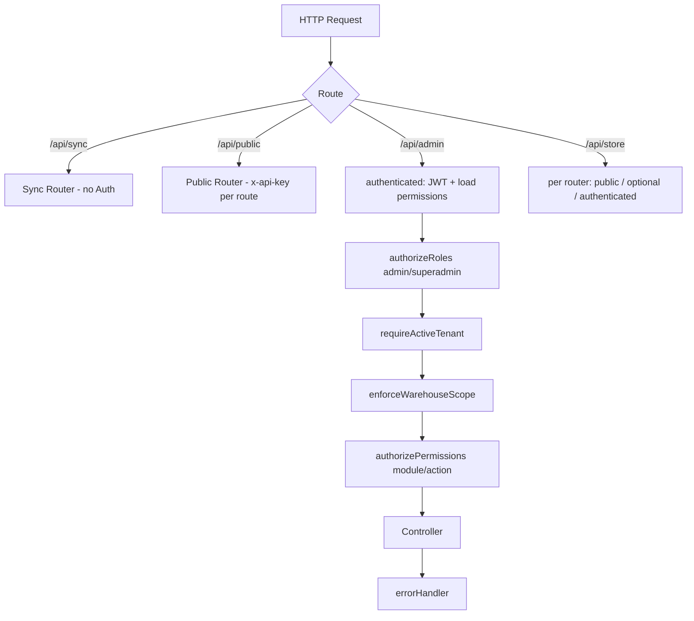

# 📘 Systego — Comprehensive Architectural and Operational Guide

> **Last updated:** November 2026
> **Document scope:** A complete and "literal" explanation of everything present in the code: runtime, layers, permissions, models, functional modules, sync, Cron, utils, scripts, and the actual notes on the code.
>
> This document is **built on the code itself** (not a theoretical design document). The detailed field reference is in [`docs/DATABASE_SCHEMA.md`](docs/DATABASE_SCHEMA.md), and the complete route reference is in [`docs/API_ENDPOINTS.md`](docs/API_ENDPOINTS.md).

---

## 📑 Table of Contents

1. [Overview and System Numbers](#1-overview-and-system-numbers)
2. [Technologies and Libraries](#2-technologies-and-libraries)
3. [Runtime Lifecycle](#3-runtime-lifecycle)
4. [Directory Structure](#4-directory-structure)
5. [Configuration and Environment Variables](#5-configuration-and-environment-variables)
6. [Request Pipeline and Protection](#6-request-pipeline-and-protection)
7. [Permissions System (RBAC)](#7-permissions-system-rbac)
8. [Data Layer — All Models](#8-data-layer--all-models)
9. [Functional Modules in Detail](#9-functional-modules-in-detail)
10. [Offline POS Sync](#10-offline-pos-sync)
11. [Scheduled Jobs and Realtime Events](#11-scheduled-jobs-and-realtime-events)
12. [Utils & Services](#12-utils--services)
13. [Runtime and Migration Scripts](#13-runtime-and-migration-scripts)
14. [Responses and Errors](#14-responses-and-errors)
15. [Developer Guide](#15-developer-guide)
16. [Known Notes and Gaps in the Current Code](#16-known-notes-and-gaps-in-the-current-code)

---

## 1. Overview and System Numbers

**Systego** is an integrated enterprise management system (**ERP**) + point of sale (**POS**) + online storefront (**Storefront**) + payment and shipping integrations, with support for multiple branches/warehouses and per-user data isolation.

### Actual numbers (extracted from the code)

| Component | Count |
|---|---|
| Registered endpoints | **568** |
| Route files | **109** |
| Mongoose Schema/Model | **98** |
| Modules in the permissions system | **80** |
| Actions per Module | **5** (`View`, `Add`, `Edit`, `Delete`, `Status`) |
| Middleware files | **13** |
| Utils files | **35** |
| Services files | **3** |
| Cron Jobs | **4** |
| Major functional groups | **13** |

### API scopes

| Scope | Prefix | Protection |
|---|---|---|
| Admin panel and POS | `/api/admin/*` | JWT + Role + Tenant + Warehouse Scope + Permissions |
| Customer storefront | `/api/store/*` | Per route: public / optional JWT / required JWT |
| Public routes | `/api/public/*` | `x-api-key` for some routes; others are public |
| POS sync | `/api/sync/*` | **No authentication at all currently** (see section 16) |
| Uploaded files | `/uploads/*` | Static (no authentication) |
| Health check | `/test-updater` | Public |

---

## 2. Technologies and Libraries

### Runtime

| Technology | Version | Usage |
|---|---|---|
| Node.js + TypeScript | `typescript ^5.9` | Runtime environment and type safety |
| Express | `^5.1.0` | HTTP Server / Routing |
| MongoDB + Mongoose | `mongoose ^8.23` | Database and models |
| Socket.IO | `^4.8.1` | Realtime notifications |
| node-cron | `^4.2.1` | Periodic jobs |
| JSON Web Token | `^9.0.2` | `Bearer` authentication (7-day validity) |
| bcryptjs / bcrypt | `^3.0.2` / `^6.0.0` | Password hashing |

### Files, reports and printing

| Library | Usage |
|---|---|
| `pdfkit` | PDF generation (receipts/reports/labels) |
| `exceljs` | Excel export (stocktake, products, reports) |
| `csv-writer` | CSV export |
| `bwip-js` | Barcode generation (Code128 and others) |
| `sharp` | Image compression/optimization |
| `multer` | File uploads |

### Integrations

| Library | Usage |
|---|---|
| `axios` | All external HTTP calls (Systego Super, Bosta, Paymob, Geidea, Fawry...) |
| `firebase-admin` | Push Notifications |
| `apple-signin-auth` | Apple sign-in |
| `google-auth-library` | Google OAuth |
| `passport` + `passport-google-oauth20` | OAuth |
| `nodemailer` + `resend` + `sib-api-v3-sdk` | Email (SMTP / Resend / Brevo) |
| `i18n` | Language support |
| `helmet`, `cors`, `express-rate-limit`, `cookie-parser`, `morgan` | Security and logging |

### Important note
`drizzle-kit` is present in `devDependencies` and the `generate-db` / `migrate-db` scripts exist, but **there is no actual use of Drizzle** in `src`. The database is MongoDB/Mongoose only, and those scripts are legacy.

---

## 3. Runtime Lifecycle

Starting point: `src/server.ts`.

### Startup steps in actual order

1. **Load `.env`** from `../../.env` relative to the file's directory (works with `dist/src/`).
2. **Enable `syncPlugin` globally** on all Mongoose models:
   ```ts
   mongoose.plugin(syncPlugin);
   ```
3. **Create the Express app** + enable:
   - `helmet({ crossOriginResourcePolicy: false })`
   - `cors({ origin: "*" })`
   - `cookieParser()`
   - `express.json({ limit: "20mb" })`
   - `express.urlencoded({ extended: true, limit: "20mb" })`
4. **Serve static files:** `/uploads` from `src/../uploads` (or `dist/../uploads`) with `maxAge: 30d` and `etag`.
5. **Connect to the database** (`connectDB`), then in order:
   - `seedOrderTypes()` — ensures `delivery` and `pickup` exist in `OrderType`.
   - `ensureWarehouseEnabled()` — backfills old branches that do not have the `enabled` field.
   - `ensureCashAccountForAllBranches()` — ensures a shared "Cash" account exists, links it to every branch, and makes it `in_POS`.
6. **Load routes:**
   - `/test-updater` → responds with `"all right 2"`.
   - `/api` → all routes (see section 6).
7. **404 Handler:** any unknown route throws `NotFound("Route not found")`.
8. **Central Error Handler.**
9. **Create the HTTP Server + Socket.IO** on the same port, and `app.set("io", io)`.
10. **Socket connection:** logs the connection and disconnection only.
11. **Start Cron:** `startCron(io)` + import `bookingcheck` (it starts its own Cron on import).
12. **Listen:** `process.env.PORT || 3000`.

### Route order in `src/routes/index.ts`

```
/api/sync     → SyncRouter          (no authentication)
/api/public   → publicRouter        (x-api-key for its routes)
/api/admin    → adminRouter
/api/store    → userRouter
```

After `/api/public`, `languageMiddleware` is applied to everything that follows.

---

## 4. Directory Structure

```text
Systego/
├── package.json
├── tsconfig.json
├── README.md
├── PROJECT_DOCUMENTATION.md        ← this file
├── API_DOCUMENTATION.md
├── docs/
│   ├── API_ENDPOINTS.md            ← 568 endpoints
│   ├── DATABASE_SCHEMA.md          ← 98 schemas
│   ├── ecommerce-online-orders-api.md
│   ├── custom-order-webhook.md
│   └── installments-ecommerce-frontend.md
├── scripts/
│   ├── optimize-existing-images.js
│   └── uuid-migration/
│       ├── 01-build-map.js
│       ├── 02-rewrite.js
│       ├── 03-verify.js
│       ├── 04-swap.js
│       ├── cleanup.js
│       ├── config.js
│       └── id-map.json
├── test/
│   └── purchase_test.ts
├── uploads/                         ← (created at runtime/on upload)
└── src/
    ├── server.ts
    ├── Errors/                      ← 12 error classes
    ├── types/                       ← constant.ts, custom.d.ts, moduleMeta.ts, generateLabel.ts...
    ├── seed/ordertype.ts
    ├── middlewares/                 ← 13 files
    ├── utils/                       ← 35 files
    │   └── shipping/                ← getBostaCreds, getSuperadminId
    ├── services/                    ← bosta, deliveryAssignment, installmentPayment
    ├── validation/                  ← Joi schemas (admin/users)
    ├── models/
    │   ├── connection.ts
    │   └── schema/
    │       ├── admin/               ← 80+ models
    │       │   └── POS/             ← Sale, ReturnSale, Shift, Customer, Sync...
    │       └── users/               ← Order, Cart, Address
    ├── controller/
    │   ├── admin/                   ← + admin/POS/
    │   ├── users/
    │   └── public/
    └── routes/
        ├── index.ts
        ├── public.ts
        ├── admin/                   ← + admin/POS/
        └── users/
```

---

## 5. Configuration and Environment Variables

All variables actually used in the code (extracted via `process.env`):

### 5.1 Basics

| Variable | Required | Usage |
|---|---|---|
| `MongoDB_URI` | ✅ | MongoDB connection (with `family: 4`, timeout 5s). If missing, the server stays alive but without a DB. |
| `PORT` | ❌ | Runtime port (default `3000`). |
| `NODE_ENV` | ❌ | `development` shows stack traces on sync failure. |
| `JWT_SECRET` | ✅ | Signing/verifying login tokens. |
| `TZ` / `TIMEZONE` | ❌ | Day boundaries in daily reports/invoice numbers. |
| `APP_URL` / `PUBLIC_APP_URL` | ❌ | Building return/notification links. |

### 5.2 Tenant and subscription (Super Systego)

| Variable | Usage |
|---|---|
| `SUPER_SYSTEGO_URL` | Base URL of the Super Systego server (example `https://superback.systego.net`). |
| `SUPER_SYSTEGO_API_KEY` | The tenant key; used for `/api/tenant/verify` and also as the `x-api-key` for webhooks. |
| `SUPER_ADMIN_SERVICE_URL` | The super admin helper service. |

> If `SUPER_SYSTEGO_URL` or the key is not configured: `requireActiveTenant` allows the request through, and `requireFeature` allows it with a warning (development mode).

### 5.3 Storefront and external integration

| Variable | Usage |
|---|---|
| `ECOMMERCE_API_KEY` | An alternative key originally intended for public ecommerce routes (accepts `ECOMMERCE_API_KEY` and then the tenant key) — **currently unused** because `ecommerceApiKey` is not mounted on any route. |
| `ECOMMERCE_WEBHOOK_API_KEY` | The key sent to the external platform in outbound requests (fallback: the tenant key). |
| `ECOMMERCE_WEBHOOK_URL` | URL of the external platform (default: `https://bcknd.smartego.org/api/webhooks/custom/order`). |

### 5.4 Payment gateways

| Variable | Usage |
|---|---|
| `PAYMOB_SECRET_KEY` | Paymob secret key. |
| `PAYMOB_HMAC_KEY` / `PAYMOB_HMAC_SECRET` | Webhook signature. |
| `PAYMOB_STRICT_HMAC` | `true` to reject any webhook without a valid HMAC. |
| `GEIDEA_SECRET_KEY`, `GEIDEA_API_BASE_URL`, `GEIDEA_CALLBACK_URL`, `GEIDEA_RETURN_URL` | Geidea settings. |
| `GEIDEA_HMAC_KEY` | Geidea signature. |
| `GEIDEA_STRICT_SIGNATURE` / `SKIP_GEIDEA_HMAC` | Tightening/skipping verification. |
| `FAWRY_RETURN_URL`, `FAWRY_STRICT_SIGNATURE` | Fawry settings. |

### 5.5 Shipping (Bosta)

| Variable | Usage |
|---|---|
| `BOSTA_API_KEY` | Bosta key (there is also per-tenant configuration in the DB). |
| `BOSTA_BASE_URL` | Base URL (the default in the Schema). |

### 5.6 Email

`RESEND_API_KEY`, `BREVO_API_KEY`, `BREVO_SENDER_EMAIL`, `EMAIL_FROM`, `EMAIL_USER`, `EMAIL_PASS`, `SMTP_FROM`, `EMAIL_VERIFICATION_SECRET`.

### 5.7 Social authentication and Push

`GOOGLE_CLIENT_ID`, `APPLE_CLIENT_ID`, `FIREBASE_PROJECT_ID`, `FIREBASE_CLIENT_EMAIL`, `FIREBASE_PRIVATE_KEY`.

### 5.8 Plesk / updates / printing

| Variable | Usage |
|---|---|
| `X_API_KEY` | Plesk key (stays on the server only). |
| `MAIN_IP`, `SERVER_PORT` | Alternative Plesk address (IP + 8443). |
| `VERSION_UPDATER_URL`, `VERSION_UPDATER_API_KEY` | Version update service. |
| `SHIFT_REPORT_PASSWORD` | Password for the shift closing report. |
| `STOCKTAKE_SHEET_PASSWORD` | Password for exporting/importing the stocktake sheet. |
| `QZ_CERT`, `QZ_PRIVATE_KEY` | QZ Tray certificate for signing. |

---

## 6. Request Pipeline and Protection

### 6.1 General chain



### 6.2 Mount order in `/api/admin`

| Order | Prefix | Protection |
|---|---|---|
| 1 | `/tenant-info` | **Before** authentication (tenant data is public) |
| 2 | `/plesk` | **Before** authentication (but the Plesk key is internal) |
| 3 | `/auth` | Public (login) |
| 4 | `/subscription` | After `authenticated` + `authorizeRoles` only |
| 5 | Remaining routes | + `requireActiveTenant` + `enforceWarehouseScope` |
| 6 | Every route inside the routers | Mostly `authorizePermissions` |

> `authorizeRoles("admin","superadmin")` applies to **everything** after line 107 in `routes/admin/index.ts`.

### 6.3 Explanation of each Middleware

| File | Function |
|---|---|
| `authenticated.ts` | Reads `Authorization: Bearer`, verifies the JWT, and loads permissions: superadmin → all modules; admin without `role_id` and with a branch → all modules; otherwise it merges `Role` permissions + `User` permissions. |
| `optionalAuthenticated.ts` | Same logic, but if there is no token or it is invalid, the request proceeds as a guest (without `req.user`). |
| `authorized.ts` | `authorizeRoles(...)` — verifies the role and returns **403** `ROLE_NOT_ALLOWED`, not 401. |
| `haspremission.ts` | `authorizePermissions(module, action)` and `authorizeAnyPermission(modules, action)`. superadmin bypasses. The error is **403** `PERMISSION_DENIED` with `required_actions` and `granted_actions`. |
| `warehouseScope.ts` | Blocks access to any branch other than the user's branch. Checks `warehouse_id` / `warehouseId` / `WarehouseId` / `fromWarehouseId` / `toWarehouseId` in `params/query/body` to a depth of 5. Excludes `transfer` and `pos/transfer` routes with special rules. Injects `warehouse_id` automatically into GET/DELETE (query) and POST/PUT/PATCH (body) if it is missing. |
| `requireActiveTenant.ts` | Calls `getTenantInfo()`; blocks when `subscription.expired` or `tenant.status === "inactive"` with code **403** `SUBSCRIPTION_EXPIRED`. If the service is not configured, the request passes. |
| `requireFeature.ts` | `requireFeature("haveEcommerce")` — blocks with **403** when the feature is missing, and **503** if verification fails. |
| `validation.ts` | Joi `validate(schema, target)` with `abortEarly: false` and `allowUnknown: true`, and replaces `req[target]` with the sanitized values. Error **400** with details. |
| `errorHandler.ts` | Handles `AppError`, `ZodError`, JWT errors, and `entity.too.large` (**413**). |
| `language.ts` | Reads `?lang=` or `?language=` or `?locale=` or `x-lang`/`x-language`. Resolves `ar_*`/`*_ar` and `en_*`/`*_en` in responses (unpacks the keys and removes the alternative). |
| `webhookApiKey.ts` | Verifies `x-api-key` against `SUPER_SYSTEGO_API_KEY` using a constant-time comparison. If the key is not configured → **503** (fail closed). |
| `ecommerceApiKey.ts` | Same idea, but it accepts `ECOMMERCE_API_KEY` first and then the tenant key. **Currently unused on any route**. |
| `generateJWT.ts` | JWT signing helper. |
| `uploadFile.ts` (utils) | Multer settings (images / Excel). |

---

## 7. Permissions System (RBAC)

### 7.1 Source

- `src/types/constant.ts`: `MODULES` (**80**), `ACTION_NAMES` = `["View","Add","Edit","Delete","Status"]`.
- `src/types/moduleMeta.ts`: Arabic/English names for each Module + grouping into 10 groups:
  `overview`, `catalog`, `sales`, `purchases`, `accounting`, `payments`, `shipping`, `ecommerce`, `reports`, `system`.

### 7.2 How user permissions are computed

```
superadmin role → all modules and all Actions
admin role + warehouse_id + no role_id → all modules and all Actions (Warehouse Admin)
admin role + role_id → merge(Role permissions, User permissions)
```

**Merging:** for each `module`, the actions are unified in a `Map` keyed by action name; user permissions override/add to the role permissions. The result is injected into `req.user.permissions`.

### 7.3 Check rules

- `authorizePermissions(module, action)`:
  - No user → **401**.
  - superadmin → pass.
  - No Module → **403**.
  - No Action → **403** with details.
- `authorizeAnyPermission([modules], action)`: passes if any Module has the action (used for installments compatibility).
- `authorizeRoles("admin","superadmin")` applies at the level of the entire admin router.

### 7.4 Practical note
**96 admin routes do not pass through `authorizePermissions`** (such as `Admin`, `AccountingLedger`, `departments`, `Geidea`, `Fawry`, and some operations routes). Their only protection is: JWT + role + tenant + Warehouse Scope. See `docs/API_ENDPOINTS.md` (Permission column = `-`).

---

## 8. Data Layer — All Models

> The complete reference for fields, types, and refs/enums: [`docs/DATABASE_SCHEMA.md`](docs/DATABASE_SCHEMA.md).
> All models use `timestamps: true` by default (except where explicitly excluded).

### 8.1 Users and permissions

| Model | File | Description |
|---|---|---|
| `User` | `admin/User.ts` | Admin user (superadmin/admin) + `role_id` + `warehouse_id` + individual permissions. |
| `Role` | `admin/roles.ts` | Custom roles + permissions array per Module. |
| `Action` | `admin/Action.ts` | Definition of the Role/Action link. |
| `Counter` | `admin/Counter.ts` | Sequential counter (document numbers). |
| `Position` | `admin/position.ts` | Job titles. |
| `Department` | `admin/departments.ts` | Departments/administrations. |

### 8.2 Catalog

`Product`, `ProductPrice`, `ProductPriceOption`, `Variation` + `Option`, `Category`, `Brand`, `Unit`, `Taxes`, `Discount`, `Coupon`, `Offers`, `Pandel` (bundle), `Banner`, `Popup`, `Point`, `redeem_Points`, `ServiceFee`, `DecimalSetting`, `Currency`.

### 8.3 Inventory and warehouses

`Warehouse`, `Product_Warehouse`, `Stock`, `Transfer`, `Stocktake` + `StocktakeItem`, `Adjustment`, `SelectReason`, `Wasted`, `PickupPoint`, `Material`, `Recipe`, `Production`, `CategoryMaterial`.

### 8.4 Point of sale (POS)

`Sale`, `ProductSale`, `Payment`, `CashierShift`, `Cashier`, `Customer`, `CustomerGroup`, `Return` (ReturnSale + ReturnItem), `Expense`, `GiftCard`, `Booking`, `ChangeLog`.

### 8.5 Purchases

`Purchase` (PurchaseSchema), `PurchaseItem`, `PurchaseItemOption`, `PurchaseInstallment`, `PurchaseInvoice`, `PurchaseDuePayment`, `Supplier`, `ReturnPurchase`, `ReturnItem`.

### 8.6 Finance

`BankAccount` (Financial_Account), `Revenue`, `RevenueCategory`, `incomecategories`, `ExpenseCategory`, `Factials` (invoices/entries), `InstallmentPlan` + `InstallmentItem`, `InstallmentSetting`, `AccountingLedger` (inside the `AccountingLedger` controller — no separate model), `payments` (Payment POS).

### 8.7 Shipping and delivery

`ShippingSettings` (Bosta + Self), `BostaShipment`, `Courier`, `DeliveryMan`, `Delivery`, `Zone`, `City`, `Country`, `PickupPoint`.

### 8.8 Storefront

`Orders` (customer orders — `users/Order.ts`), `Cart`, `Address`, `AppSetting` (store/theme settings), `EcommerceData` (store/header/footer data), `Notification`.

### 8.9 Integrations and settings

`PaymentMethod`, `Paymob`, `Geidea`, `Fawry`, `OrderType`, `ShippingSettings`, `VersionUpdater` (no model).

> **Notes:** There is an empty file `admin/delivryorder.ts` (0 bytes), and internal helper schemas such as `PermissionSchema`, `RolePermissionSchema`, `bostaAddressSchema`, `selfConfigSchema`, `ReturnItemSchema`.

---

## 9. Functional Modules in Detail

> For each module: purpose, most important routes (prefix), and the most important business rules. The full list is in `docs/API_ENDPOINTS.md`.

### 9.1 Authentication, tenant, users, and permissions

**Routes:** `/api/admin/auth`, `/api/admin/tenant-info`, `/api/admin/subscription`, `/api/admin/profile`, `/api/admin/admin`, `/api/admin/permission`, `/api/admin/version-updater`, `/api/admin/decimal-setting`, `/api/admin/notification`, `/api/admin/plesk`, `/api/admin/db`.

**Key behavior:**
- `POST /auth/login`: login with `email` + `password`.
  - Rejects an inactive account and an inactive role.
  - `x-pos-client: true` + a user without `warehouse_id` → **400** `USER_NO_WAREHOUSE` (a clear message for the POS app).
  - **Does not block login when the subscription has expired**, so the customer can reach the renewal page.
  - Returns the open shift data (if any) + financial accounts + permissions.
- `tenant-info`: fetch/update tenant data, and it has an endpoint to refresh the cache (`refresh`).
- `subscription`: send a payment request/screenshot and payment status to Super Systego.
- `permission`: create/update/delete Roles, fetch `modules & actions`, update role permissions.
- `version-updater`: `check`, `sync`, `status`, `sync-frontend`, `sync-backend` via the PleskVersionUpdater service (15-minute timeout).
- `plesk`: secure proxy for only specific Plesk endpoints (`/api/v2/cli/subscription/call`, `/api/v2/cli/site/call`) while hiding `x-api-key`.
- `db`: direct gateway for `read/count/write/edit/delete` operations on any Mongoose Model (dangerous — see section 16).

### 9.2 Products and catalog

**Routes:** `/api/admin/product`, `/category`, `/brand`, `/variation`, `/units`, `/category_material`, `/offer`, `/banner`, `/popup`, `/discount`, `/coupon`, `/point`, `/redeem-points`, `/pandel`.

**Notable rules:**
- The product supports: multiple prices/variations (`ProductPrice` + Options), wholesale (`whole_price` when `start_quantaty` is exceeded), sales/purchase/inventory units, tax, brand, multiple categories, images, IMEI, online/featured flags.
- Import products and categories from Excel (`uploadExcelFile().single("file")`).
- Generate a product code, an image barcode, and print labels in multiple sizes.
- The bundle (`Pandel`) contains products with quantities and variants, and its component stock is deducted on sale.
- Loyalty points: `Point` (earning rules) and `redeem_Points` (redemption rules).

### 9.3 Inventory, warehouses and stocktake

**Routes:** `/warehouse`, `/product_warehouse`, `/stock`, `/transfer`, `/stocktake`, `/adjustment`, `/selectreason`, `/wasted`, `/pos-wasted`, `/pickup-point`, `/label`, `/qztray`.

**Notable rules:**
- `Product_Warehouse` is the source of truth for each product/variant quantity inside each branch (+ `low_stock_threshold`, `expiry_date`).
- Transfer between warehouses: on creation the quantities are reserved, and on approval (`approved`) they are deducted from the source and added to the destination. For POS there is a simplified route `POSTransferController` that forces the transfer source = the cashier's branch and allows a different destination.
- Stocktake (`Stocktake`): create, edit items, bulk update, export/import a password-protected Excel sheet, submit (`submit`) which applies the differences, cancel, delete, and resolve items (`resolve`).
- `Adjustment`: an increase/decrease adjustment with a reason (`SelectReason`).
- `Wasted`: recording waste and reducing inventory + statistics + status change.
- Labels/barcode: `GET /label/sizes`, `POST /label/generate`. QZ Tray: `GET /qztray/cert`, `POST /qztray/sign`.

### 9.4 POS, shifts and customers

**Routes:** `/api/admin/pos/*`, `/pos-home`, `/cashier-shift`, `/cashiershift`, `/cashier`, `/return-sale`, `/pos-booking`, `/booking`, `/gift-card`, `/pos_customer`, `/pos/warehouse`, `/pos/transfer`, `/expense`, `/pos-online-orders`, `/pos/installments`, `/customer`.

#### A. Creating a sale invoice (`POST /api/admin/pos/sales`)
The actual steps in `saleController.createSale`:
1. Extract `cashierId` and `warehouseId` from the token; the user must have a branch.
2. **An open shift is required** for the cashier (`CashierShift.status = open`).
3. Prepare the products:
   - If `product_price_id`: the price comes from `ProductPrice`.
   - Apply the wholesale price: if `qty >= product.start_quantaty` and `whole_price > 0` → `final = price × (whole_price / product.price)`.
   - Line discount: `fixed` or `percentage`.
   - Gift products (`isGift`) are not included in the total.
4. Prepare bundles and break them down into products while deducting the stock of each component.
5. Calculate:
   - `service_fee_total` from `service_fee_ids` (with `module = pos` and `warehouseId`).
   - `Discount`: a **fraction**-based percentage (0.1 = 10%), otherwise a fixed amount.
   - `Coupon`: a **whole-number** percentage (10 = 10%) or `flat`.
   - `free_discount` (manual discount): requires **the user's own password** (`bcrypt`), and is capped at a maximum = the remainder after discounts.
   - `Taxes`: a **fraction**-based percentage.
   - `gift_card_amount` + `service fees` + `shipping`.
   - `grand_total = max(0, subtotal - discount - coupon - gift - ... + tax + fees + shipping)`.
6. Validate payments (`financials`) using **cents** logic:
   - Completed sale: total payments = `grand_total`.
   - Installments: total payments = **the down payment** only.
   - Deferred sale (`Due=1`) and pending (`order_pending=1`) do not require payments.
7. Deduct inventory atomically (`findOneAndUpdate` + quantity conditions) and prevent selling into negative.
8. Automatically deduct recipe (`Recipe`) components for products that have a recipe.
9. Deduct the coupon and gift card atomically (`$inc` with a balance condition).
10. Save `Sale` + `ProductSale` + `Payment`, update the customer's points, and create an `InstallmentPlan` for installments.
11. The response contains printing data (printer type/IP/Port/Name) and store data.

**Important constraints:** An order cannot be both pending and deferred; installments are not compatible with deferred/pending.

#### B. Shifts
- Open a shift: `POST /cashier-shift/open` (opening balance + cashier + branch).
- Close: `POST /cashier-shift/close` or `POST /cashier-shift/end` — computes the expected amount (cash sales + opening - expenses) against the actual amount, and records the shortage/overage. The closing report may require `SHIFT_REPORT_PASSWORD`.
- `GET /cashier-shift/current` and `/cashier-shift/cashiers`.
- Additional report routes: `GET /cashiershift`, `GET /cashiershift/:id`, `PUT /cashiershift/:id/close`, and cashier reports at `/admin/admin/shifts/:shift_id/details` and `/report/:id`.

#### C. Returns
- `POST /return-sale` (and `POST /return-sale/sales/:saleId` depending on the router): returns quantities to inventory, reverses payments/points, and updates `return_status` (`none/partial/full`) and `returned_amount`/`returned_quantity` on the invoice.
- Queries: returnable invoices, all returns, return details, invoice returns.

#### D. Bookings (Booking)
- `GET/POST /pos-booking`: book a product/variant with a number of days.
- Hourly Cron: a pending booking that exceeded `number_of_days` becomes `failer` and the quantity is returned to the product/variant.
- `GET /booking`, `GET /booking/:id` for viewing.

#### E. Gift cards, customer groups, customers
- `GiftCard`: create/view/redeem/update.
- `CustomerGroup`: CRUD + group customers.
- `Customer`: CRUD + `due` + `with-orders` + `single-page/:id` + `:id/orders` + countries/cities.
- `POS Home`: aggregates all point-of-sale screen data (categories, brands, products, featured, bundles, cashier, accounts, taxes, discounts, coupons, gift, payment methods, customers, groups, deferred customers, currency, countries, service fees, inventory).

#### F. POS installments
`/api/admin/pos/installments`: settings, preview, plans, plan, due installments, pay installment, customer plans. Payment is recorded on a financial account and updates the installment/plan status.

### 9.5 Purchases, suppliers and manufacturing

**Routes:** `/purchase`, `/return-purchase`, `/supplier`, `/recipe`.

- Creating a purchase invoice: product/raw material line items, quantities, prices, expiry, warehouse, supplier, cash/deferred/installments. It increases inventory and updates `Product_Warehouse` and stock movement.
- `purchase/installments/:id/pay`: pay a purchase installment.
- Reports: low stock, nearing expiry, actually expired, selection.
- Purchase return: returns quantities to the supplier and deducts from inventory.
- Suppliers: CRUD + account statement.
- Manufacturing: `Recipe` links the finished product to raw materials, and `produceProductFromRecipe` performs production (deduct materials + add product), with a production log.

### 9.6 Finance and accounts

**Routes:** `/bank_account`, `/ledger`, `/revenue`, `/expenseAdmin`, `/expensecategory`, `/payable`, `/receivable`, `/finicial-report`, `/payment`, `/service-fees`, `/currency`, `/taxes`, `/installments`.

- **Financial accounts:** `BankAccount` with balance/branch/type/`in_POS` fields; support for adding/removing branches, transferring money between accounts (`transferMoney`).
- **Ledger:** `GET /ledger` and `/ledger/:id` (aggregation of entries/payments).
- **Revenue:** CRUD + selection + `RevenueCategory`.
- **Expenses:** administrative (`expenseAdmin`) and POS expenses (`expense`), plus categories.
- **Payables/Receivables:** `payable` (suppliers) and `receivable` (customers) + add transactions.
- **Service fees:** CRUD + enable/disable + branches.
- **Taxes and currencies:** CRUD.
- **Decimal configuration:** `DecimalSetting` (number of decimal places).
- **Financial reports:** `GET /finicial-report` (income statement/profits).
- **Ecommerce/admin installments:** `/installments` settings + plans + due installments + payment + edit item + cancel.

### 9.7 Shipping and delivery

**Routes:** `/shipping`, `/delivery-man`, `/delivery-assignment`, `/courier`, `/zone`, `/city`, `/country`.

- **ShippingSettings** is a single document per superadmin: the active method (`self` or `bosta`).
  - Self: zone-based pricing (`zone`) or a flat rate (`flat_rate`).
  - Bosta: API key/baseUrl/environment/pickup/defaults/COD/webhook/markup (fixed or percentage)/auto pickup.
  - `freeShippingEnabled` + the list of free-shipping products.
- **Bosta:** connection test, cities/zones, pickup points list and setting the default, shipment/zone/insurance pricing, creating a shipment from an order or in bulk or a return, daily pickups, live tracking + update + history, sync, cancel, shipping label, statistics.
- **DeliveryMan:** CRUD + `currentOrders` + `maxConcurrentOrders` (default 10).
- **DeliveryAssignment:** manual assignment only (automatic assignment is explicitly disabled), unassign, status update, available couriers, courier orders, order delivery info. It selects an active pickup point and uses its branch as the warehouse.
- **Couriers / Zones / Cities / Countries:** CRUD and zone pricing.

### 9.8 Storefront (admin)

**Routes:** `/online-orders`, `/orders`, `/ecommerce-data`, `/store-settings`, `/order-type`, `/banner`, `/popup`, `/offer`.

- **Online Orders:** list with `status` and `shippingMethod` filters, details, status update (Self or Bosta with allowed status lists), bulk shipment creation, update Bosta address, soft delete.
  - Self statuses: `unassigned, assigned, picked_up, out_for_delivery, delivered, failed, returned`.
  - Bosta statuses: `PendingPickup, Pickup requested, Picked up, In transit, Out for delivery, Delivered, Cancelled, Failed to deliver, Returned`.
  - General display statuses: `pending, confirmed, processing, out_for_delivery, delivered, returned, failed_to_deliver, canceled, scheduled`.
- **Orders:** view all orders/details/report.
- **Ecommerce Data:** store data (name/phone/email/address/social/header/footer/logo/status).
- **Store Settings:** store theme (`templateSlug`), section snapshots, name/logo/font/colors/enabled sections. Storefront routes for browsing themes (`browseThemesCategories`, `browseThemesBySlug`, `getCategoryThemes`).
- **Order Types:** `delivery` and `pickup` with enable/disable.

### 9.9 Reports and dashboard

**Routes:** `/dashboard`, `/product-report`, `/product-movement`, `/report-filters`.

- Dashboard: overall indicators + quick statistics.
- Product Report: product sales (quantity/revenue/period/branch/category) + selection.
- Product Movement: product movement (purchases/sales/transfers/adjustments/waste) + selection.
- Report Filters: shared filter options (branches/categories/brands/suppliers...).

### 9.10 Payment gateways and integrations

**Routes:** `/paymob`, `/geidea`, `/fawry`, `/payment_method`.

- **Paymob:** settings per payment method, create/edit/view. Storefront payment via Iframe + `paymobOrderId` + Webhook HMAC.
- **Geidea:** settings + Webhook HMAC (with strict/skip options).
- **Fawry:** settings + Webhook `messageSignature`.
- **Payment Methods:** CRUD for payment methods used in POS and the storefront.
- **Actual order webhooks:** `GET|POST /api/store/order/webhook/{paymob,geidea,fawry}`.
- **Verification:** `GET /api/store/order/verify-payment/paymob/:orderId`.
- **Default payment behavior:** for manual payment, `paymentGateway = manual` and `paymentStatus` depends on collection.

### 9.11 Customer storefront (Storefront)

**Routes:** `/api/store/*` — details in `API_DOCUMENTATION.md`.

- **Auth:** signup (`signup`) + login + OTP + complete/edit profile + Google + Apple.
- **Catalog:** products/categories/brands/banners/offers/bundles + best sellers (combines POS + Online) + search and filtering.
- **Wishlist / Address / Cart:** JWT (some optional), a cart that syncs (`syncCart`) and supports coupons and emptying.
- **Order:** `checkout` (supports `full` and `installment`), `my-orders`, details, status by reference, and Paymob payment verification.
- **Installments:** general settings + preview + customer plans.
- **Shipping:** the active shipping method + cities/zones/Bosta pricing for the customer.
- **Store Settings / Ecommerce Data / Tenant Info:** store and theme data.

### 9.12 Public routes and ecommerce integration

- `GET /api/public/products` — public products (no key, for compatibility).
- `GET|POST /api/public/orders/accept?id=...` — moves the order to `processing` (requires `x-api-key`).
- `GET|POST /api/public/orders/reject?id=...` — moves the order to `canceled`.
- **Outbound order:** on `POST /api/store/order/checkout`, Systego sends a copy to the external platform (`ECOMMERCE_WEBHOOK_URL`) in a fire-and-forget manner, and stores `externalOrderId` if it comes back from the platform.
- Product images are served from `/uploads/...`.

### 9.13 POS sync

Full detail in section 10.

---

## 10. Offline POS Sync

### 10.1 Components

- `src/models/schema/admin/POS/syncPlugin.ts` — a global Mongoose Plugin that records changes.
- `src/models/schema/admin/POS/ChangeLog.ts` — the change log.
- `src/models/schema/admin/POS/sync.ts` — the `table → Model` map (39 tables).
- `src/controller/admin/POS/sync.ts` — Bootstrap / Push / Pull.

### 10.2 Tracked tables (39)
`Booking, Brand, Cashier, CashierShift, Category, City, Country, Coupon, Currency, Customer, CustomerGroup, Discount, ExpenseCategory, Expense, Fawry, BankAccount, Geidea, GiftCard, Notification, Orders, Pandel, Payment, PaymentMethod, Paymob, Position, Product, ProductPrice, ProductPriceOption, Product_Warehouse, Return, Role, Sale, ProductSale, ServiceFee, Taxes, User, Variation, Option, Warehouse`.

### 10.3 Cumulative numeric fields (`$inc` instead of `$set`)
- `Category.product_quantity`
- `Coupon.amount/quantity/available`
- `Currency.amount`
- `Customer.total_points_earned/amount_due`
- `BankAccount.balance`
- `Product.quantity`
- `ProductPrice.quantity`
- `Product_Warehouse.quantity`
- `Warehouse.number_of_products/stock_Quantity`

Reason: prevent lost updates when more than one device syncs at the same time (last-write-wins is unsafe for balances).

### 10.4 Endpoints

| Route | Method | Function |
|---|---|---|
| `/api/sync/bootstrap/:table?cursor=` | GET | Paginated initial load (500 rows/page) with `nextCursor`, `serverSnapshotAt`, `totalCount`, `loadedCount`. |
| `/api/sync/push` | POST | Upload the client's changes `{ clientId, changes:[{id,table_name,record_id,op,payload,created_at}] }`. |
| `/api/sync/pull?since=ISO&clientId=` | GET | Fetch server changes after `since` while excluding changes from the same `clientId`. |

### 10.5 Push rules
- **Idempotency:** if `sourceChangeId` exists in `ChangeLog` → it is considered applied.
- **`insert`:** upsert by `record_id`, sanitizing `null` values (strings become `""`, and other types are removed).
- **`update`:** supports `set` and `inc` and `arrayPatch` (`added`, `updated` with deltas/values, `removed`).
- **`delete`:** hard delete.
- **Legacy `upsert`:** Full-row + `updatedAt` comparison to preserve last-write-wins behavior for old clients.
- Result: `{ applied: [ids], failed: [{id, reason}] }`, and development errors show the stack.

### 10.6 Security note
`/api/sync/*` is **not protected by any authentication** in `routes/index.ts`. Anyone who knows the URL can Bootstrap/Pull/Push. (Mentioned in section 16.)

---

## 11. Scheduled Jobs and Realtime Events

### 11.1 Cron Jobs

| File | Schedule | Function |
|---|---|---|
| `utils/expiry_lowstock.ts` | `0 15 * * *` (3:00 PM) | Products expiring within **7 days** → `expiry` notification. |
| Same file | `30 15 * * *` (3:30 PM) | Products already expired → `expired` notification. |
| Same file | `0 16 * * *` (4:00 PM) | Products below `low_stock` → `low_stock` notification. |
| `utils/bookingcheck.ts` | `0 * * * *` (every hour) | Pending bookings that exceeded `number_of_days` → `failer` + return the quantity to the product/variant. |

**Notes:**
- Low stock notifications depend on `Product.quantity` and `low_stock` (not `Product_Warehouse`).
- No duplicate notifications are created for the same product/condition if there is an unread notification.
- Expiry notifications are created at the `PurchaseItem` level (`date_of_expiery`, `quantity > 0`).

### 11.2 Socket.IO
- Runs on the same HTTP Server with `cors: "*"`.
- The `notification` event is broadcast when a notification is created (from the Cron).
- There is no authentication on the connection, and no rooms/scoping (all connected clients receive it).

---

## 12. Utils & Services

### 12.1 Utils (35 files)

| File | Function |
|---|---|
| `auth.ts` | `generateToken` (7d) and `verifyToken`. |
| `response.ts` | `SuccessResponse` — `{ success:true, data }`. |
| `catchAsync.ts` | A wrapper that forwards async errors to the errorHandler. |
| `barcode.ts` / `generateCodeStock.ts` | Barcode/stock code generation. |
| `genrateLabel.ts` | Generate PDF labels/barcodes in multiple sizes. |
| `handleImages.ts` | Save Base64/images + `saveBase64Image`. |
| `uploadFile.ts` | Multer settings (images/Excel) and upload paths. |
| `deleteImage.ts` | Delete an image file. |
| `emailTemplate.ts` | Email templates (OTP/welcome/notifications). |
| `sendEmails.ts` | Send via SMTP/Resend/Brevo. |
| `firebase.ts` | Initialize Firebase Admin for notifications. |
| `storehelper.ts` | Helper store/branch data. |
| `producthelper.ts` | Product and inventory helpers. |
| `branchLimit.ts` | Branch limits by plan/configuration. |
| `reportFilters.ts` | Shared report filters. |
| `installment.ts` | Compute the installment schedule (interest/down payment/rounding the last installment), plan CRUD. |
| `ensureCashAccount.ts` | Ensure a shared Cash account for all branches. |
| `ensureWarehouseEnabled.ts` | backfill `enabled` for old branches. |
| `accounting` (inside Controllers) | Financial entries. |
| `expiry_lowstock.ts` | Notifications Cron. |
| `bookingcheck.ts` | Bookings Cron. |
| `externalOrderSync.ts` | Send the order to the external platform + extract `externalOrderId`. |
| `paymobService.ts` / `paymobWebhook.ts` | Create payment + HMAC verification + update the order. |
| `geadiaService.ts` / `geadiawebhook.ts` | Geidea. |
| `fawryService.ts` / `fawryWebhook.ts` | Fawry. |
| `tenantService.ts` | Verify subscription/features via Super Systego + 5-minute Cache + `clearCache`. |
| `superAdmin.client.ts` | Super admin service client. |
| `versionUpdater.ts` | PleskVersionUpdater client. |
| `dbGateway.ts` | The `/api/admin/db/gateway` router (generic CRUD on models). |
| `shipping/getBostaCreds.ts` | Fetch the Bosta settings for the tenant. |
| `shipping/getSuperadminId.ts` | Determine the superadmin that owns the data. |
| `Qztray.ts` | QZ Tray signing. |

### 12.2 Services (3)

| File | Function |
|---|---|
| `bosta.service.ts` | All Bosta calls (cities/zones/pricing/shipments/pickup/tracking/cancel/label). |
| `deliveryAssignment.service.ts` | Courier assignment (manual only), capacity, pickup point, status update. |
| `installmentPayment.service.ts` | Record installment payments on financial accounts. |

---

## 13. Runtime and Migration Scripts

| Script | Function |
|---|---|
| `npm run dev` | `ts-node-dev --respawn --transpile-only src/server.ts`. |
| `npm run build` | `tsc`. |
| `npm start` | `node dist/src/server.js`. |
| `npm run generate-db` / `migrate-db` | Drizzle (not actually used). |
| `npm run migrate` | UUID migration chain: `map → rewrite → verify → swap`. |
| `npm run optimize-images` | Optimize existing images via `sharp`. |

### UUID Migration scripts (`scripts/uuid-migration`)
- `01-build-map.js`: build a map of old → new IDs (`id-map.json`).
- `02-rewrite.js`: rewrite references in documents.
- `03-verify.js`: verify migration integrity.
- `04-swap.js`: swap the fields after success.
- `cleanup.js`, `config.js`.

### Testing
- `test/purchase_test.ts`: a manual test file for purchase operations (not wired to a test runner).

---

## 14. Responses and Errors

### 14.1 Success

```json
{
  "success": true,
  "data": { "...": "..." }
}
```

Some routes return `data` containing `message` and `count` and additional entities (such as installment plans and orders).

### 14.2 Error

```json
{
  "success": false,
  "error": {
    "code": 403,
    "message": "No permission to Add in POS",
    "details": {
      "code": "PERMISSION_DENIED",
      "module": "POS",
      "required_actions": ["Add"],
      "granted_actions": ["View"]
    }
  }
}
```

### 14.3 Common codes

| Code | Condition |
|---|---|
| `400` | Validation / Bad Request / Joi. |
| `401` | Invalid/expired token, or an incorrect API key. |
| `403` | Role not allowed (`ROLE_NOT_ALLOWED`), missing permission (`PERMISSION_DENIED`), branch not allowed (`WAREHOUSE_SCOPE_DENIED`), expired subscription (`SUBSCRIPTION_EXPIRED`), feature unavailable. |
| `404` | Entity/route not found. |
| `409` | Conflict (Unique/Conflict). |
| `413` | Request/image size larger than the limit (the message says 10MB while the actual limit is 20MB). |
| `500` | Unexpected error (the stack is printed on the server). |
| `502` | Plesk Proxy failure. |
| `503` | Webhook key not configured, or subscription verification failed. |

### 14.4 Error classes (`src/Errors`)
`AppError` (base) + `BadRequest`, `UnauthorizedError`, `ForbiddenError`, `NotFound`, `ConflictError`, `ValidationError`, `DatabaseError`, `ForeignKeyConstraintError`, `NotNullConstraintError`, `UniqueConstraintError`, `index.ts`.

---

## 15. Developer Guide

### 15.1 Adding a new Module (model → controller → route → permission)

1. **Model:** `src/models/schema/admin/YourModel.ts` with `timestamps`, a correct `ref` for relations, and `warehouse_id` if the entity is branch-scoped.
2. **Validation:** `src/validation/admin/YourModel.ts` (Joi).
3. **Controller:** `src/controller/admin/YourModel.ts` — use `SuccessResponse`, `catchAsync`, and `Errors` errors.
4. **Route:** `src/routes/admin/YourModel.ts` — use `validate` and `authorizePermissions("yourKey","View|Add|Edit|Delete")`.
5. **Mount:** add `route.use("/your-path", YourRouter)` in `src/routes/admin/index.ts`.
6. **Permission Module:** add the key to `MODULES` in `types/constant.ts` and to `MODULE_META` in `types/moduleMeta.ts` (so it appears in the permissions screen).
7. **Sync:** if the entity must sync offline, add it to `TRACKED_TABLES` and `syncableModels` and (if numeric) `INCREMENTAL_NUMERIC_FIELDS`.

### 15.2 Fixed rules in the code

- Use `warehouse_id` from `req.user` (or leave it to `enforceWarehouseScope`) and do not trust the body.
- Inventory deduction must be **atomic** with a quantity condition (`quantity: { $gte: qty }` + `$inc: -qty`).
- Use `toCents`/cents comparison for payments (present in `saleController`).
- Any `Discount`/`Taxes` percentage = a **fraction** (`0.1` = 10%), while a `Coupon` percentage = a **whole number** (`10` = 10%).
- Installments are not allowed with deferred/pending, and an open shift is required for a normal sale.
- Add `authorizePermissions` to every new admin route.
- Do not change `syncPlugin` or `ChangeLog` fields without reviewing the sync impact.

### 15.3 Quick run and test

```bash
npm run dev
curl http://localhost:3000/test-updater
curl -X POST http://localhost:3000/api/admin/auth/login -H "Content-Type: application/json" -d "{\"email\":\"...\",\"password\":\"...\"}"
```

---

## 16. Known Notes and Gaps in the Current Code

> This section documents **reality**, not the ideal design, so that the guide is honest and actionable.

1. **`/api/sync/*` has no authentication** — Bootstrap/Pull/Push are available to any requester. JWT/device key should be added.
2. **`/api/admin/db/gateway`** — generic CRUD on any Mongoose Model through the body (`table`, `operation`). It is protected only by JWT/role, but it allows reading/modifying any table. It is preferable to disable it in production.
3. **`/api/admin/plesk` is before authentication** — it relies on the internal Plesk key and endpoint restriction, but it is exposed without JWT.
4. **Geidea/Fawry/AccountingLedger/Admin/departments** — routes without `authorizePermissions` (96 admin routes in total).
5. **`ecommerceApiKey` is unused** — the middleware exists but `/api/public/online-orders` is **not wired** in `routes/public.ts`; what actually exists is only `orders/accept` and `orders/reject`.
6. **`docs/ecommerce-online-orders-api.md`** used to document `POST /api/public/online-orders`, which is not registered currently — it has been corrected to reflect reality.
7. **`Materials`** — there is a controller and a Model but no Router (`src/routes/admin/Materials.ts` does not exist). Raw material management is done via `Category_Material`/`Recipe` or directly from the DB.
8. **Empty files:** `models/schema/admin/delivryorder.ts`, `routes/admin/DueCustomer.ts`, `routes/admin/income_categories.ts`, `validation/admin/Factials.ts`, `validation/admin/Materials.ts`, `validation/admin/Recipe.ts`.
9. **CORS `*` + uploads up to 20MB** — and the error message says 10MB.
10. **Socket.IO without Auth** — any client receives all notifications.
11. **Automatic courier assignment is explicitly disabled** (`autoAssignOrder` returns `assigned: false`).
12. **The `tenantService` comment says a 10-minute Cache, but the actual value is 5 minutes**.
13. **File/route names with historical spelling mistakes:** `dsashboard`, `finicial-report`, `barnd`, `geadia*`, `Notfication`, `genrateLabel`, `delivryorder`. They are not renamed to avoid breaking the frontends.
14. **Conceptually duplicated routes:** `/cashiershift` and `/cashier-shift`; `/payment` and `/payments`; `/expense` and `/expensesAdmin`; `/order-type` in admin and the storefront.
15. **Drizzle scripts are unused** — there are no Drizzle schemas.
16. **Low Stock notifications depend on `Product.quantity`** rather than the sum of `Product_Warehouse`, so they may differ from the branch stock.
17. **`/api/public/products` is public without a key** (for compatibility).
18. **Pagination is not standardized** — each controller uses `page/limit` or `cursor` or returns everything. Check the specific route.

---

> **Conclusion:** Systego is a large and intertwined system, but it is functionally coherent: a hybrid permissions layer (Role + User + Warehouse), a POS with real offline sync, multi-provider shipping/payment integration, and a complete storefront. The generated reference documents (`API_ENDPOINTS.md`, `DATABASE_SCHEMA.md`) are the literal source for any field or route detail.
